

  
  

 

 

  

 

I'm a B.E. Computer Science and Engineering graduate from Annamalai University. I like building small, practical software that people actually use, mostly for students and fellow developers. I work with **JavaScript**, **PHP**, **Laravel**, and more. Some of it is open source, some of it is client work, and all of it ships.

 

  

 

  

## Things I've built

  <a href="https://github.com/amudhan-mohan/ausmarthub">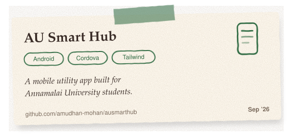</a>
  <a href="https://renderping.amudhanmohan.in/">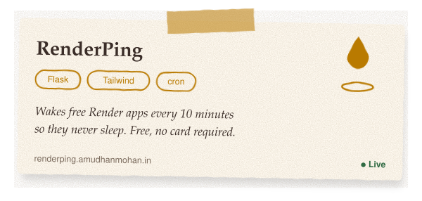</a>
  <a href="https://github.com/amudhan-mohan/annamalai-university-cgpa-ogpa">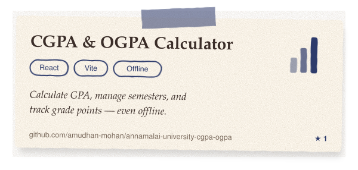</a>
  <a href="https://github.com/amudhan-mohan/nptel-calculator">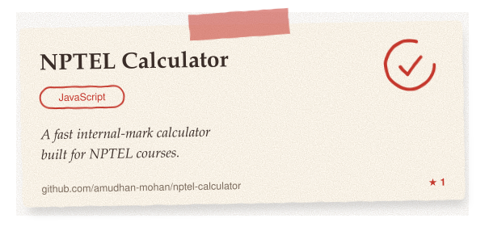</a>

 

  <a href="https://github.com/amudhan-mohan?tab=repositories">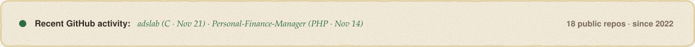</a>

 

## GitHub contributions

  <a href="https://github.com/amudhan-mohan">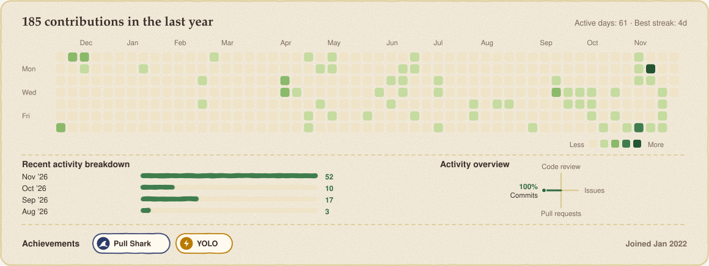</a>

 

## Why RenderPing exists

Render puts a free web service to sleep after 15 minutes without traffic, and the next visitor waits 30 to 90 seconds for it to wake up. RenderPing sends your app a request every 10 minutes from a server, so it is already awake when someone shows up. You can close the tab and it keeps going. It's meant for portfolios, demos, and staging apps — not for production workloads.

 

  <a href="https://renderping.amudhanmohan.in/"></a>

 

  

## Websites for clients

  

 

## What I work with

  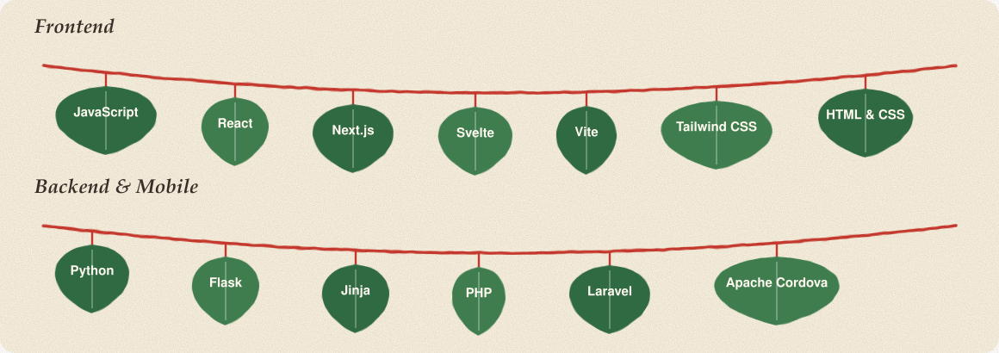

 

### Explore repositories by language

<!-- LANGUAGES:START -->

  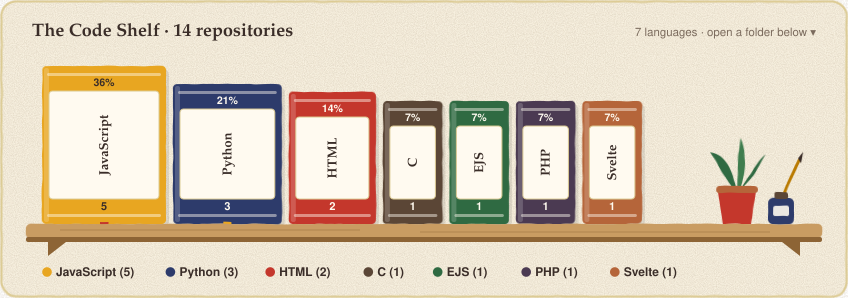

  
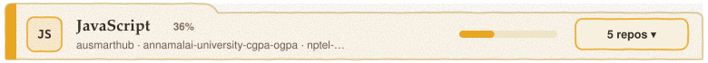

   
  

    <a href="https://github.com/amudhan-mohan/ausmarthub">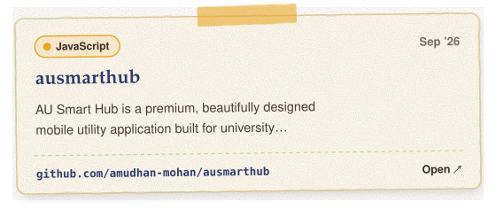</a>
    <a href="https://github.com/amudhan-mohan/annamalai-university-cgpa-ogpa">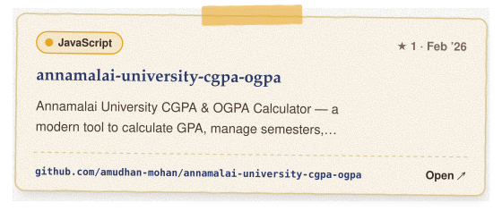</a>
    <a href="https://github.com/amudhan-mohan/nptel-calculator">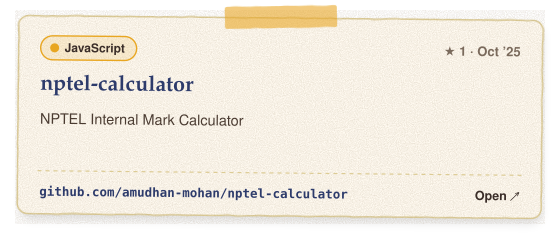</a>
    <a href="https://github.com/amudhan-mohan/SignUp">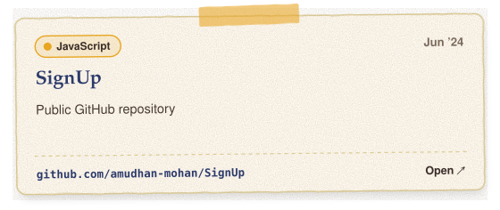</a>
    <a href="https://github.com/amudhan-mohan/Money-Tracker">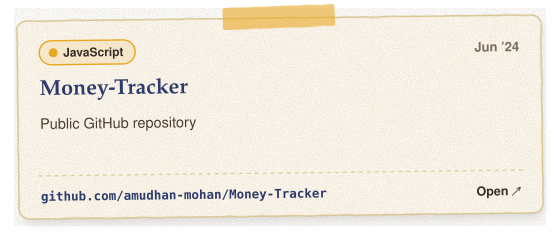</a>
  

  
<strong>Repository URLs:</strong> <a href="https://github.com/amudhan-mohan/ausmarthub">ausmarthub</a> (<a href="https://ausmarthub.amudhanmohan.in/">Live ↗</a>) &nbsp;&middot;&nbsp; <a href="https://github.com/amudhan-mohan/annamalai-university-cgpa-ogpa">annamalai-university-cgpa-ogpa</a> (<a href="https://github.amudhanmohan.in/annamalai-university-cgpa-ogpa/">Live ↗</a>) &nbsp;&middot;&nbsp; <a href="https://github.com/amudhan-mohan/nptel-calculator">nptel-calculator</a> (<a href="https://github.amudhanmohan.in/nptel-calculator/">Live ↗</a>) &nbsp;&middot;&nbsp; <a href="https://github.com/amudhan-mohan/SignUp">SignUp</a> &nbsp;&middot;&nbsp; <a href="https://github.com/amudhan-mohan/Money-Tracker">Money-Tracker</a>

  
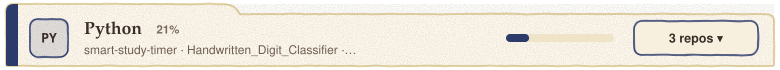

   
  

    <a href="https://github.com/amudhan-mohan/smart-study-timer">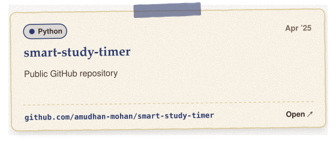</a>
    <a href="https://github.com/amudhan-mohan/Handwritten_Digit_Classifier">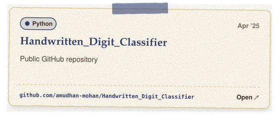</a>
    <a href="https://github.com/amudhan-mohan/Email_Spam_Detection">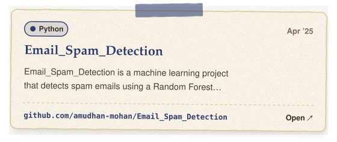</a>
  

  
<strong>Repository URLs:</strong> <a href="https://github.com/amudhan-mohan/smart-study-timer">smart-study-timer</a> &nbsp;&middot;&nbsp; <a href="https://github.com/amudhan-mohan/Handwritten_Digit_Classifier">Handwritten_Digit_Classifier</a> &nbsp;&middot;&nbsp; <a href="https://github.com/amudhan-mohan/Email_Spam_Detection">Email_Spam_Detection</a> (<a href="https://amudhan-mohan.github.io/Email_Spam_Detection/">Live ↗</a>)

  
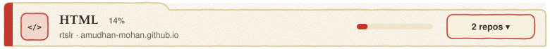

   
  

    <a href="https://github.com/amudhan-mohan/rtslr">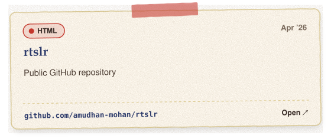</a>
    <a href="https://github.com/amudhan-mohan/amudhan-mohan.github.io">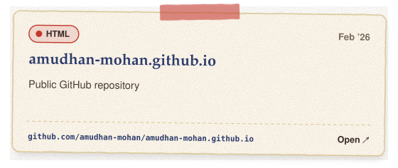</a>
  

  
<strong>Repository URLs:</strong> <a href="https://github.com/amudhan-mohan/rtslr">rtslr</a> &nbsp;&middot;&nbsp; <a href="https://github.com/amudhan-mohan/amudhan-mohan.github.io">amudhan-mohan.github.io</a> (<a href="http://github.amudhanmohan.in/">Live ↗</a>)

  
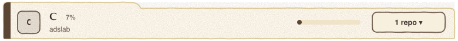

   
  

    <a href="https://github.com/amudhan-mohan/adslab">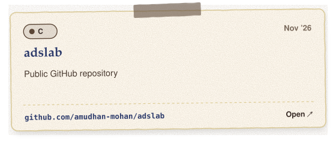</a>
  

  
<strong>Repository URL:</strong> <a href="https://github.com/amudhan-mohan/adslab">adslab</a>

  
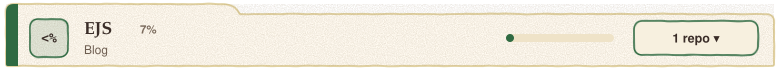

   
  

    <a href="https://github.com/amudhan-mohan/Blog">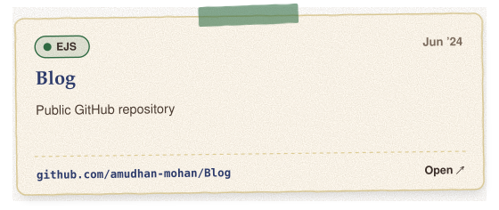</a>
  

  
<strong>Repository URL:</strong> <a href="https://github.com/amudhan-mohan/Blog">Blog</a>

  
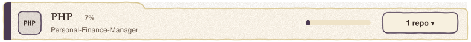

   
  

    <a href="https://github.com/amudhan-mohan/Personal-Finance-Manager">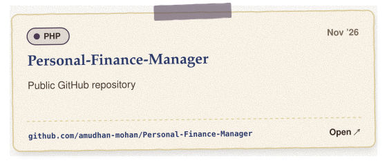</a>
  

  
<strong>Repository URL:</strong> <a href="https://github.com/amudhan-mohan/Personal-Finance-Manager">Personal-Finance-Manager</a>

  
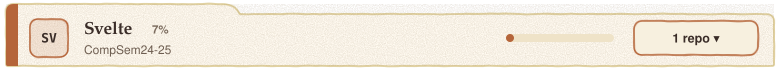

   
  

    <a href="https://github.com/amudhan-mohan/CompSem24-25">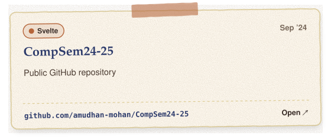</a>
  

  
<strong>Repository URL:</strong> <a href="https://github.com/amudhan-mohan/CompSem24-25">CompSem24-25</a>

<!-- LANGUAGES:END -->

 

## Say hello

  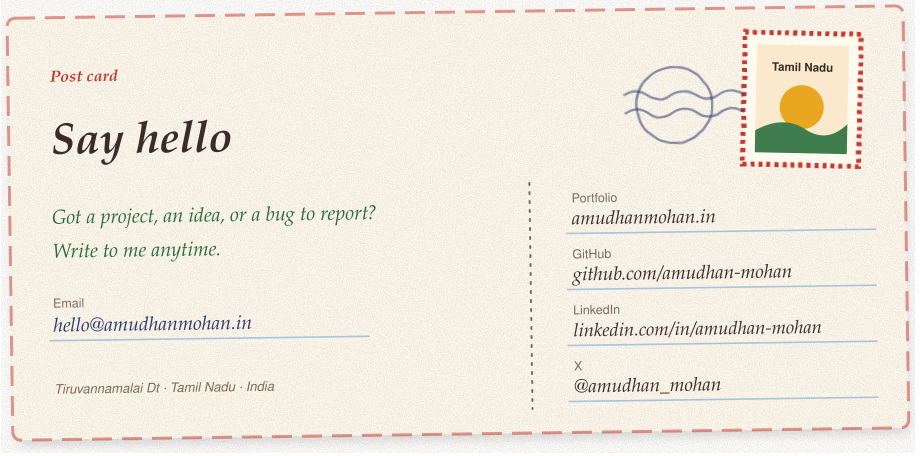

 

  <strong>Email:</strong> <a href="mailto:hello@amudhanmohan.in">hello@amudhanmohan.in</a> &nbsp;&middot;&nbsp; <strong>Portfolio:</strong> <a href="https://amudhanmohan.in">amudhanmohan.in</a> &nbsp;&middot;&nbsp; <a href="https://github.amudhanmohan.in">github.amudhanmohan.in</a> 
  <strong>LinkedIn:</strong> <a href="https://www.linkedin.com/in/amudhan-mohan/">amudhan-mohan</a> &nbsp;&middot;&nbsp; <strong>X:</strong> <a href="https://x.com/amudhan_mohan">@amudhan_mohan</a> &nbsp;&middot;&nbsp; <strong>Support:</strong> <a href="https://github.com/sponsors/amudhan-mohan">Sponsor my work</a>

 

  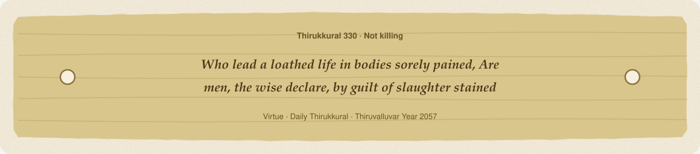

  

    

     
    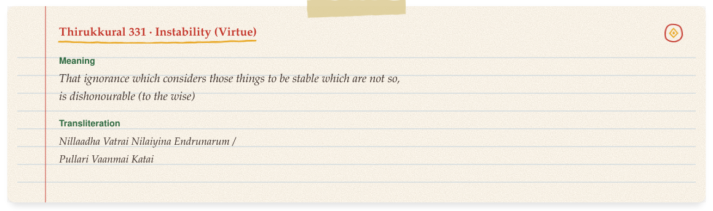
  

 

  

