

  
  

 

 

  

 

நான் அண்ணாமலைப் பல்கலைக்கழகத்தில் B.E. CSE (கணினி அறிவியல் மற்றும் பொறியியல்) பட்டம் பெற்ற டெவலப்பர். மாணவர்களுக்கும் சக டெவலப்பர்களுக்கும் உண்மையிலேயே பயன்படும் சிறிய, நடைமுறை மென்பொருள்களை உருவாக்குவது எனக்குப் பிடிக்கும். **JavaScript**, **PHP**, **Laravel** உள்ளிட்ட தொழில்நுட்பங்களில் வேலை செய்கிறேன். சில திறந்த மூல (open source) திட்டங்கள், சில வாடிக்கையாளர் வேலைகள் — எல்லாமே முடிக்கப்பட்டு வெளியாகின்றன.

 

  

 

  

## நான் உருவாக்கியவை

  <a href="https://github.com/amudhan-mohan/ausmarthub">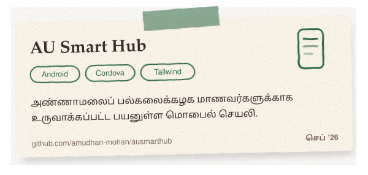</a>
  <a href="https://renderping.amudhanmohan.in/">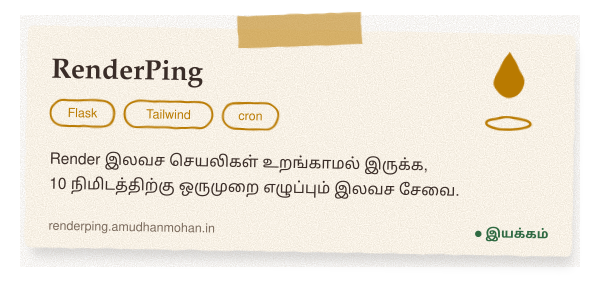</a>
  <a href="https://github.com/amudhan-mohan/annamalai-university-cgpa-ogpa">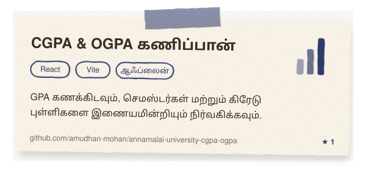</a>
  <a href="https://github.com/amudhan-mohan/nptel-calculator">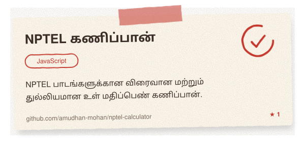</a>

 

  <a href="https://github.com/amudhan-mohan?tab=repositories">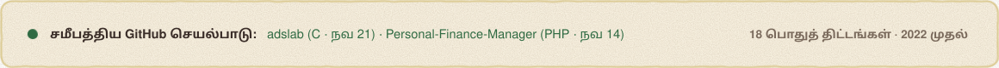</a>

 

## GitHub பங்களிப்புகள்

  <a href="https://github.com/amudhan-mohan">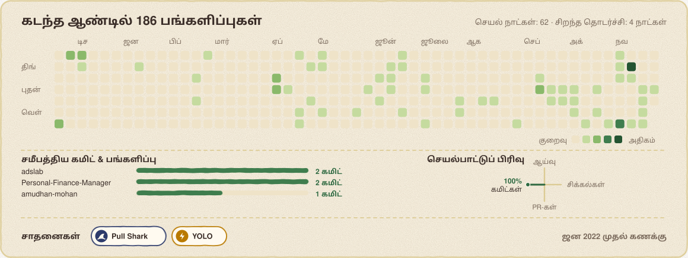</a>

 

## RenderPing ஏன்?

Render-இன் இலவச வெப் சர்வீஸ், 15 நிமிடம் யாரும் வராவிட்டால் உறங்கிவிடும்; அடுத்து வருபவர் 30 முதல் 90 வினாடி காத்திருக்க வேண்டியிருக்கும். RenderPing ஒவ்வொரு 10 நிமிடத்திற்கும் சர்வரிலிருந்து உங்கள் செயலிக்கு ஒரு கோரிக்கை அனுப்புகிறது, அதனால் பார்வையாளர் வரும்போது அது ஏற்கனவே விழித்திருக்கும். டேபை மூடினாலும் இது தொடர்ந்து வேலை செய்யும். இது போர்ட்ஃபோலியோ, டெமோ, ஸ்டேஜிங் செயலிகளுக்காக; புரொடக்ஷன் பணிகளுக்காக அல்ல.

 

  <a href="https://renderping.amudhanmohan.in/"></a>

 

  

## வாடிக்கையாளர்களுக்கான இணையதளங்கள்

  <a href="https://amudhanmohan.in">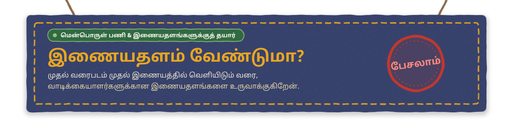</a>

 

## நான் பயன்படுத்தும் கருவிகள்

  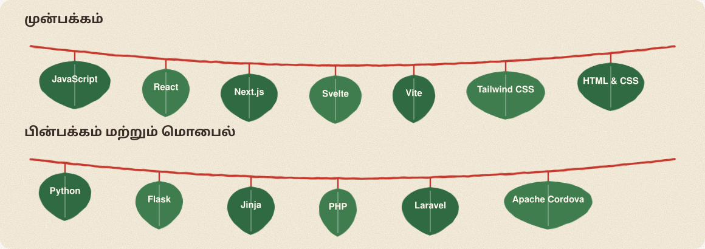

 

### மொழி வாரியாக GitHub திட்டங்கள்

<!-- LANGUAGES:START -->

  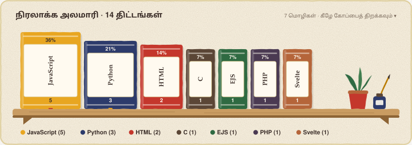

  

   
  

    <a href="https://github.com/amudhan-mohan/ausmarthub">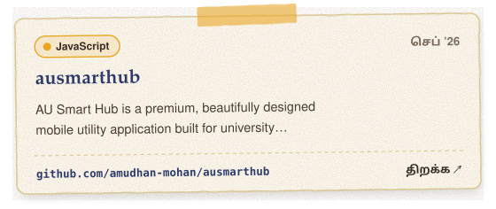</a>
    <a href="https://github.com/amudhan-mohan/annamalai-university-cgpa-ogpa">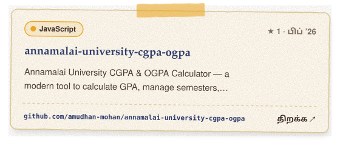</a>
    <a href="https://github.com/amudhan-mohan/nptel-calculator">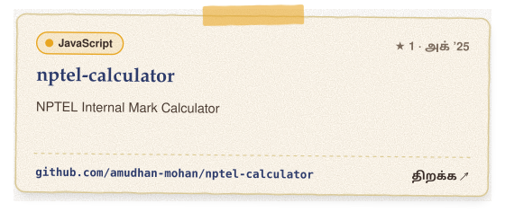</a>
    <a href="https://github.com/amudhan-mohan/SignUp">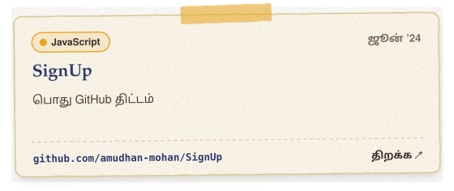</a>
    <a href="https://github.com/amudhan-mohan/Money-Tracker">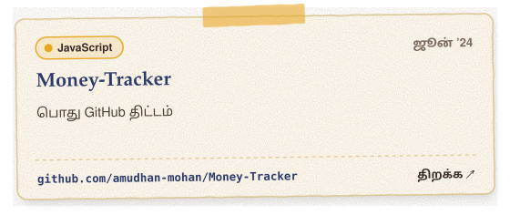</a>
  

  
<strong>திட்ட இணைப்புகள்:</strong> <a href="https://github.com/amudhan-mohan/ausmarthub">ausmarthub</a> (<a href="https://ausmarthub.amudhanmohan.in/">நேரலை ↗</a>) &nbsp;&middot;&nbsp; <a href="https://github.com/amudhan-mohan/annamalai-university-cgpa-ogpa">annamalai-university-cgpa-ogpa</a> (<a href="https://github.amudhanmohan.in/annamalai-university-cgpa-ogpa/">நேரலை ↗</a>) &nbsp;&middot;&nbsp; <a href="https://github.com/amudhan-mohan/nptel-calculator">nptel-calculator</a> (<a href="https://github.amudhanmohan.in/nptel-calculator/">நேரலை ↗</a>) &nbsp;&middot;&nbsp; <a href="https://github.com/amudhan-mohan/SignUp">SignUp</a> &nbsp;&middot;&nbsp; <a href="https://github.com/amudhan-mohan/Money-Tracker">Money-Tracker</a>

  
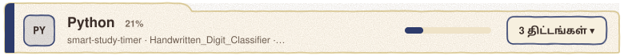

   
  

    <a href="https://github.com/amudhan-mohan/smart-study-timer">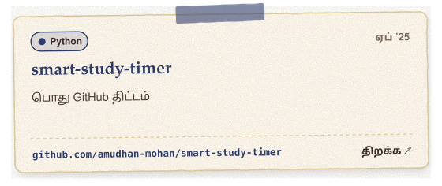</a>
    <a href="https://github.com/amudhan-mohan/Handwritten_Digit_Classifier">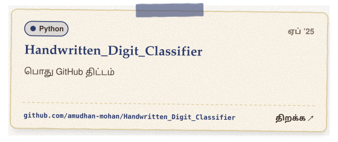</a>
    <a href="https://github.com/amudhan-mohan/Email_Spam_Detection">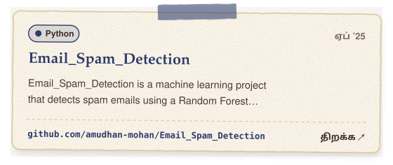</a>
  

  
<strong>திட்ட இணைப்புகள்:</strong> <a href="https://github.com/amudhan-mohan/smart-study-timer">smart-study-timer</a> &nbsp;&middot;&nbsp; <a href="https://github.com/amudhan-mohan/Handwritten_Digit_Classifier">Handwritten_Digit_Classifier</a> &nbsp;&middot;&nbsp; <a href="https://github.com/amudhan-mohan/Email_Spam_Detection">Email_Spam_Detection</a> (<a href="https://amudhan-mohan.github.io/Email_Spam_Detection/">நேரலை ↗</a>)

  
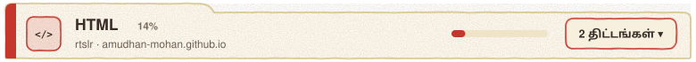

   
  

    <a href="https://github.com/amudhan-mohan/rtslr">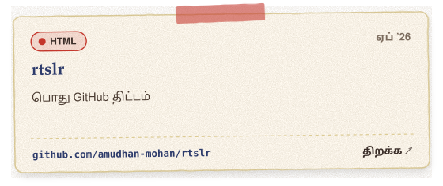</a>
    <a href="https://github.com/amudhan-mohan/amudhan-mohan.github.io">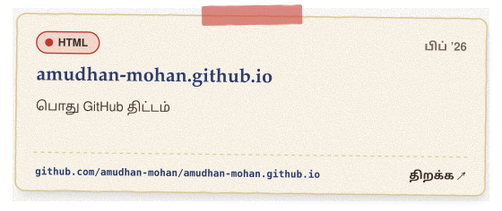</a>
  

  
<strong>திட்ட இணைப்புகள்:</strong> <a href="https://github.com/amudhan-mohan/rtslr">rtslr</a> &nbsp;&middot;&nbsp; <a href="https://github.com/amudhan-mohan/amudhan-mohan.github.io">amudhan-mohan.github.io</a> (<a href="http://github.amudhanmohan.in/">நேரலை ↗</a>)

  

   
  

    <a href="https://github.com/amudhan-mohan/adslab">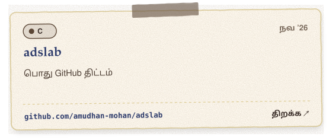</a>
  

  
<strong>திட்ட இணைப்பு:</strong> <a href="https://github.com/amudhan-mohan/adslab">adslab</a>

  
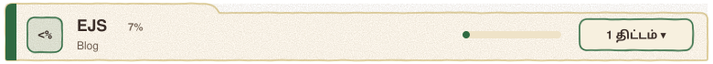

   
  

    <a href="https://github.com/amudhan-mohan/Blog">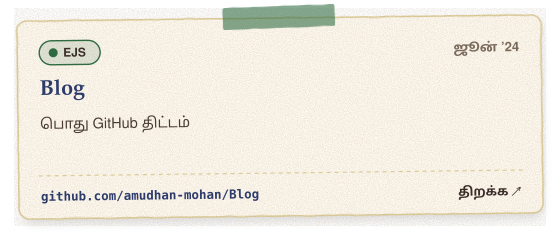</a>
  

  
<strong>திட்ட இணைப்பு:</strong> <a href="https://github.com/amudhan-mohan/Blog">Blog</a>

  

   
  

    <a href="https://github.com/amudhan-mohan/Personal-Finance-Manager">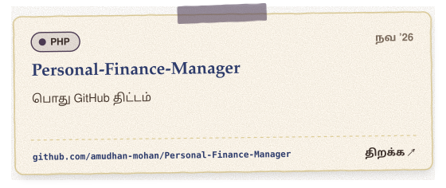</a>
  

  
<strong>திட்ட இணைப்பு:</strong> <a href="https://github.com/amudhan-mohan/Personal-Finance-Manager">Personal-Finance-Manager</a>

  
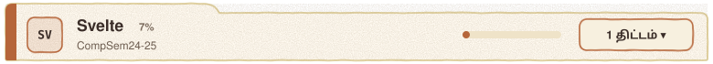

   
  

    <a href="https://github.com/amudhan-mohan/CompSem24-25">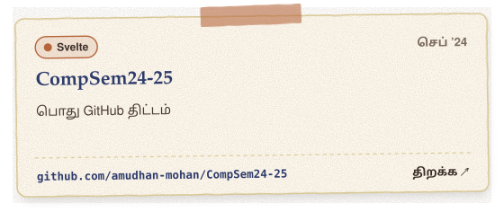</a>
  

  
<strong>திட்ட இணைப்பு:</strong> <a href="https://github.com/amudhan-mohan/CompSem24-25">CompSem24-25</a>

<!-- LANGUAGES:END -->

 

## தொடர்புக்கு

  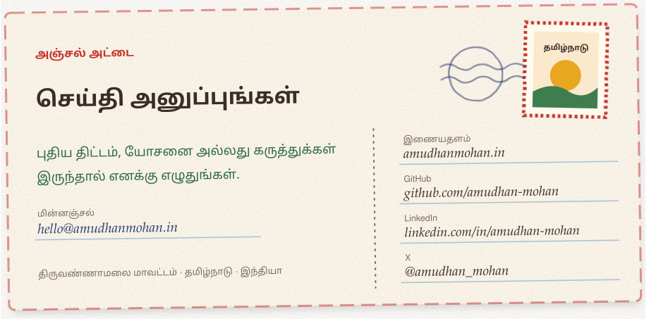

 

  <strong>மின்னஞ்சல்:</strong> <a href="mailto:hello@amudhanmohan.in">hello@amudhanmohan.in</a> &nbsp;&middot;&nbsp; <strong>இணையதளம்:</strong> <a href="https://amudhanmohan.in">amudhanmohan.in</a> &nbsp;&middot;&nbsp; <a href="https://github.amudhanmohan.in">github.amudhanmohan.in</a> 
  <strong>LinkedIn:</strong> <a href="https://www.linkedin.com/in/amudhan-mohan/">amudhan-mohan</a> &nbsp;&middot;&nbsp; <strong>X:</strong> <a href="https://x.com/amudhan_mohan">@amudhan_mohan</a> &nbsp;&middot;&nbsp; <strong>ஆதரவு:</strong> <a href="https://github.com/sponsors/amudhan-mohan">GitHub Sponsors</a>

 

  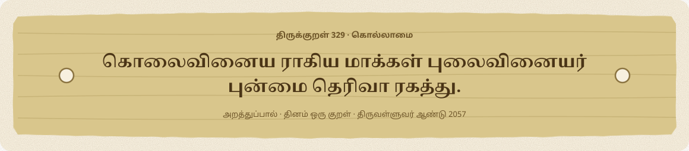

  

    

     
    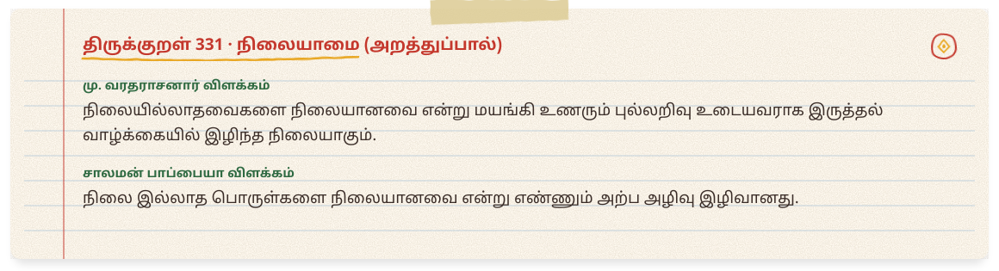
  

 

  

